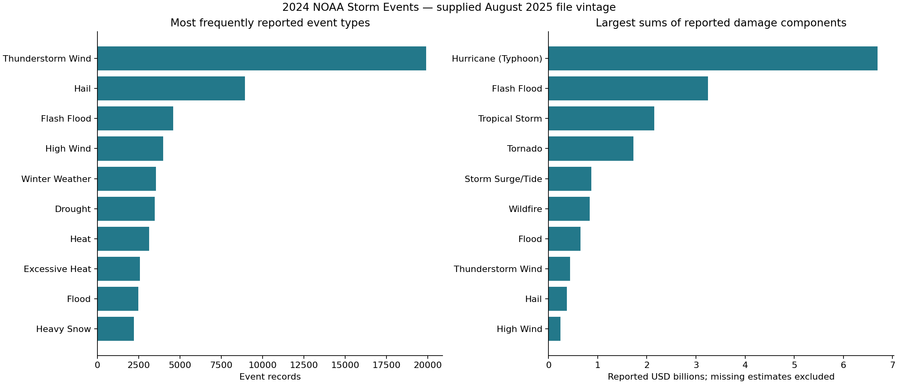
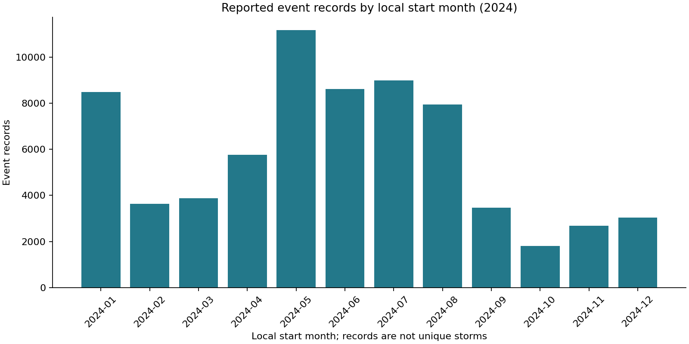

# Severe Weather Impact Dashboard

This independent portfolio project examines reported weather impacts using the supplied NOAA Storm Events details file. It combines documented data-quality checks, exploratory analysis and an interactive Power BI report for historical weather decision support.

This project includes inspection, documented cleaning, exploratory summaries, four Matplotlib figures and a local interactive Power BI project. It does not include machine learning or forecasts. The findings describe historical reports in one file vintage.

## Explore the project

- [Download the finished Power BI report](power_bi/SevereWeather_Impact_Report.pbix?raw=true) and open it in Power BI Desktop. The report contains the data needed for viewing.
- [View monthly impacts](analysis_outputs/monthly_impacts.png) or [compare reporting across locations](analysis_outputs/location_comparisons.png).
- Read the findings and data-quality decisions below, or inspect `analyze_weather.py` and `build_power_bi.py` for the reproducible workflow.

## Get the source data

The original 69 MB CSV, the regenerated cleaned dataset, the event-level Power BI CSV, machine-specific Power BI caches and the earlier report backup are excluded from Git. The original CSV remains unchanged in the local project. Summary tables, quality audits, charts, the DAX measures and the final PBIX are included. The editable Power BI project definitions and import query are generated by `build_power_bi.py` and excluded from Git; running the builder recreates them with the correct local data path.

Before running the analysis from a fresh clone, download the [supplied 2024 file vintage](https://raw.githubusercontent.com/oedp/noaa_storm_events/main/StormEvents_details-ftp_v1.0_d2024_c20250818.csv.gz), decompress it, and save the expanded CSV beside the scripts as `noaa_storm_events_2024.csv`. In PowerShell, this Python command downloads and expands that exact mirror filename:

```powershell
python -c "import gzip, pathlib, urllib.request; url='https://raw.githubusercontent.com/oedp/noaa_storm_events/main/StormEvents_details-ftp_v1.0_d2024_c20250818.csv.gz'; pathlib.Path('noaa_storm_events_2024.csv').write_bytes(gzip.decompress(urllib.request.urlopen(url).read()))"
```

This command requires an internet connection. The file name pins a NOAA creation-date vintage, but the mirror branch can change; compare the downloaded CSV's SHA-256 with the provenance fingerprint below before assuming the results will match. Run the analysis to regenerate the excluded cleaned and event-level data.

The editable Power BI project and saved PBIX retain a local CSV source path from the computer where they were generated. Viewing the saved PBIX works without that path. To refresh on your computer, run both scripts from the clone, open the regenerated `.pbip`, refresh, and save your own PBIX. Keep the report and semantic-model folders together.

## Reproduce the analysis

Use Python 3.11 or later. The verified environment was Python 3.13.7, pandas 3.0.0 and matplotlib 3.10.8. Open a terminal in this project folder and run:

```powershell
python -m pip install -r requirements.txt
python analyze_weather.py
python build_power_bi.py
```

The script reads `noaa_storm_events_2024.csv` beside the script and writes to `analysis_outputs/`. No network connection is needed after the dependencies and input are available. Existing generated files with the same names are replaced on rerun. The source CSV is never rewritten. A run can take a few minutes because it reads and compresses the narratives.

The finished report to open is **`power_bi/SevereWeather_Impact_Report.pbix`**. It includes the refreshed data, two interactive pages and full-value cards. The earlier `power_bi/SevereWeather.pbix` is a preserved backup from before the final card-formatting change.

`build_power_bi.py` creates the editable local project in `power_bi/SevereWeather.pbip`; it does not create a PBIX binary. To reproduce the report from source, run both scripts, open the `.pbip` in Power BI Desktop, refresh the local CSV and use **Save As → Power BI file (.pbix)**. See the Power BI section below for details. Rebuilding regenerates the report definition, so save manual layout edits as a separate PBIX or a copy of the project before rerunning the builder.

Optional paths:

```powershell
python analyze_weather.py --input "C:\path\noaa_storm_events_2024.csv" --output-dir "C:\path\analysis_outputs"
```

To inspect the cleaned file in Python while keeping identifier columns as text:

```python
import pandas as pd

events = pd.read_csv(
    "analysis_outputs/cleaned_events_2024.csv.gz",
    dtype={"EVENT_ID": "string", "EPISODE_ID": "string",
           "STATE_FIPS": "string", "CZ_FIPS": "string",
           "TOR_OTHER_CZ_FIPS": "string"},
    parse_dates=["BEGIN_LOCAL_DATETIME", "END_LOCAL_DATETIME"],
    keep_default_na=False,
    na_values=[""],
)
```

The CSV format does not store pandas types. Blank output cells represent missing values. Do not fill damage columns with zero when loading them elsewhere.

## Data provenance and vintage

- Original source: [NOAA NCEI Storm Events Database](https://www.ncei.noaa.gov/access/storm-events-database/).
- Supplied download: [OEDP GitHub mirror, 2024 details file](https://raw.githubusercontent.com/oedp/noaa_storm_events/main/StormEvents_details-ftp_v1.0_d2024_c20250818.csv.gz). The mirror was used because the NOAA server timed out. The local expanded file is named `noaa_storm_events_2024.csv`.
- The supplied filename identifies data year **2024** and file creation date **August 18, 2025**, using NOAA's `d`/`c` naming convention. This is a fixed snapshot; later NOAA corrections are not incorporated. Download time was not recorded.
- The local CSV has **69,361,691 bytes**, **69,493 records** and **51 columns**. It has not been independently matched byte-for-byte to a NOAA-hosted original. The hash identifies the local file analyzed, not an authenticated NOAA download.
- SHA-256 of the original local CSV: `6cb952bef90c9735b32b8cdf813010561a0bc0f1c926c42e11277a57efecf6ef`.

Definitions were checked against NOAA's [bulk CSV field guide](https://www.ncei.noaa.gov/pub/data/swdi/stormevents/csvfiles/Storm-Data-Bulk-csv-Format.pdf), [Storm Data Preparation Instructions, July 26, 2021](https://www.weather.gov/media/directives/010_pdfs/pd01016005curr.pdf) (sections 2.1, 2.3 and 2.7), and [Storm Events FAQ](https://www.ncdc.noaa.gov/stormevents/faq.jsp). The legacy FAQ address may redirect to the database site.

NOAA defines an episode as a grouping that can contain several events; `EVENT_ID` identifies an event record. `CZ_TYPE` distinguishes county/parish (`C`), forecast zone (`Z`) and marine (`M`). Times are generally local standard time. Property and crop fields contain estimated damage amounts, with K and M representing thousands and millions. These definitions guide the checks below; observed conflicts with the file are retained and documented.

## Inspection and cleaning, step by step

1. **Fingerprint and load the source.** Compute SHA-256, then load every field as text. This prevents accidental conversion of IDs and codes. Only empty cells are initially missing; strings such as `NA` are not automatically treated as missing. Verify that all 51 expected fields are present and report unexpected fields.
2. **Profile completeness and uniqueness.** Record each original column's missing count, missing percentage, distinct nonmissing values and cleaned type in `column_profile.csv`. Count exact duplicate excess rows and repeated event IDs. The supplied file has neither. Stop on a missing or repeated event ID rather than silently choosing a record. Repeated episode IDs are expected.
3. **Standardize blanks conservatively.** Trim surrounding spaces in non-narrative fields and replace empty cells with nullable missing values. No non-narrative values needed trimming in this file. Preserve narrative spacing verbatim and retain all rows. Do not impute absent magnitudes, flood causes or tornado attributes: many are event-specific fields rather than universally required observations.
4. **Validate numeric fields.** Convert calendar components, casualty counts, magnitude, category, tornado dimensions, ranges and coordinates to numeric types. Keep IDs and location codes as text. Flag failed conversions, negative values where inappropriate and fractional values in integer fields. Check identifier/code syntax. `numeric_profile.csv` reports counts, minima, medians and maxima. No numeric-conversion, negative-value or integer-format problems were found. Positive longitudes and negative latitudes can be valid for the included territories; they are not automatically errors.
5. **Parse and cross-check dates.** Parse the observed `DD-MON-YY HH:MM:SS` strings explicitly, using an English month mapping and a 20xx year for this 2024-specific analysis. Independently reconstruct timestamps from year/month/day and HHMM fields. Check agreement, month labels, start year, valid HHMM values and end-before-start. All 69,493 start/end pairs parsed and agreed with their components; none had negative duration. Preserve the original date text and time-zone labels. Add local timestamps, local start month and duration in hours. No UTC or daylight-saving correction is inferred. The file contains 36 daylight-named labels (18 `PDT-7`, 16 `EDT-4`, 2 `CDT-5`), which are flagged for review rather than relabeled.
6. **Parse reported damage.** Keep `DAMAGE_PROPERTY` and `DAMAGE_CROPS` as source text. Convert nonnegative numbers with K/M/B suffixes to USD using multipliers of 1,000 / 1,000,000 / 1,000,000,000. Round converted USD to cents to remove floating-point arithmetic artifacts (for example, `4.18M` must become $4,180,000 rather than $4,179,999.9999999995). This does not change the supplied estimates' monetary values. An unsuffixed number is accepted as dollars; all nonblank values in this file used K, M or B. The parser accepts suffix case differences. Missing or unsupported text stays missing in the numeric result; unsupported text is separately flagged. Each value receives `missing`, `invalid`, `reported_zero` or `reported_positive` status. Every nonblank damage value parsed successfully. NOAA's preparation instructions allow unavailable estimates to be recorded separately; a blank is not evidence of zero loss.
7. **Keep complete and partial damage separate.** Add `DAMAGE_TOTAL_COMPLETE_USD` only when both property and crop estimates are known. In summaries, each component is summed over its known records, with known/unknown counts and coverage percentages beside it. All-missing sums remain missing. `available_damage_components_usd_sum` adds whichever property/crop components are reported; it is a partial accounting measure. `complete_case_damage_usd_sum` uses only records with both components. Neither measure estimates the missing losses.
8. **Audit geography.** Preserve `STATE`, `STATE_FIPS`, `CZ_TYPE`, `CZ_FIPS` and `CZ_NAME`. Add `MARINE_CONTEXT` when a record has one of the explicitly listed water-region names, a `Marine ...` event label or `Waterspout`. This is an audit flag, not a corrected official geography. Add `NOAA_AREA_KEY` as `STATE|CZ_TYPE|three-digit CZ_FIPS` for grouping. It is not a Census GEOID. Check coordinate bounds and missing pairs; report coordinate coverage separately by location type and marine context.
9. **Explore reporting frequency and impacts.** Summarize records by exact event label, state/region, local start month, location type/marine context and NOAA reporting area. Include distinct episode counts, direct/indirect casualty sums and damage coverage. Do not pool magnitude across hazards: wind and hail use different units. Export magnitude statistics by event type and magnitude label, plus the 20 largest property-damage records for review. Draw event-type frequency/damage, monthly record counts, monthly damage/casualties/coverage and location comparisons. Export one row per event without narratives for Power BI; the data remains at event-record granularity.
10. **Verify the results.** Check that each grouped table reconciles to the input record count and the cleaned casualty/damage sums. Verify that missing damage remains missing and reported zeros remain zero. Recompute the original CSV hash at the end to confirm it is unchanged. Save run versions, provenance, totals, date range and issue counts in `quality_report.json`.

No rows were deleted, no event labels were merged, and no unverified source value was corrected. Raw date text, raw damage notation, IDs, codes and narratives remain available in the cleaned file. The original numeric measurements are represented as numbers; non-narrative blanks are represented as missing. Parse failures, if encountered, are recorded with source text in `quality_issues.csv`.

## Results from the supplied file

### Coverage and data quality

There are **69,493 unique event records**, **9,861 distinct episode IDs**, **51 distinct event labels** and **68 state/region labels**. Start times span **January 1, 2024, 00:00** through **December 31, 2024, 23:30** in the recorded local times. These region labels include states, territories and bodies of water.

| Damage field | Reported zero | Reported positive | Missing | Known coverage |
| --- | ---: | ---: | ---: | ---: |
| Property | 40,228 | 14,174 | 15,091 | 78.28% |
| Crops | 52,881 | 1,152 | 15,460 | 77.75% |

Both components are known for **52,342 records**; both are missing for **13,400 records**. The remaining **3,751** have only one component. An explicit zero is a reported value, not independent confirmation that no damage occurred.

The file contains **39,598 `C` records** and **29,895 `Z` records**, with **no `M` records**. However, **2,538 records** are marine-context records and are labeled `Z`. They remain `Z`; the audit flag makes the discrepancy visible. Of the remaining 27,357 zone records, none has beginning coordinates. County records have beginning coordinates in 39,597 of 39,598 cases, and marine-context records in 2,451 of 2,538. In total, **27,445 records lack beginning coordinates (39.49%)**. A point-only map would omit most nonmarine zone hazards.

Territory examples also show why the source codes should not be joined directly to Census data: `STATE_FIPS` is `99` for Puerto Rico, `98` for Guam, `97` for American Samoa and `96` for the Virgin Islands in this file. A verified crosswalk is needed before any Census geography join.

`CATEGORY` has 76 populated values associated with hurricane labels, despite the older bulk guide describing the field as historically unpopulated. Those values are retained and numerically profiled; no new category definition is imposed. The labels `Hurricane (Typhoon)` (49 records) and `Hurricane` (27) are both present and kept separate. The reported 51 labels are not a claim that NOAA defines exactly 51 official hazard categories.

The only issue categories found were **2,538 marine-designator review flags** and **36 daylight-time-label review flags**. These are source interpretation issues, not grounds for deleting records. The schema/missingness profiles also preserve structural absences such as tornado fields on non-tornado records.

### Frequency, timing and reported impacts

| Exact event label | Event records |
| --- | ---: |
| Thunderstorm Wind | 19,918 |
| Hail | 8,938 |
| Flash Flood | 4,591 |
| High Wind | 3,993 |
| Winter Weather | 3,555 |

**May has the most records (11,176)**, followed by July (8,994) and June (8,616). **September has the largest sum of available reported damage components: $11,757,485,670**, even though it has 3,467 records. Report frequency and reported impact therefore tell different stories in this snapshot. A single year's monthly pattern does not establish a long-term seasonal baseline.

Reported property components sum to **$15,410,425,630**, and reported crop components sum to **$2,255,106,410**. Their available-component sum is **$17,665,532,040**. Restricting to the 52,342 records with both estimates gives **$17,143,743,380**. The difference reflects omitted one-sided records, not an estimate of unknown losses.

| Exact event label | Available reported property + crop components |
| --- | ---: |
| Hurricane (Typhoon) | $6,692,560,000 |
| Flash Flood | $3,244,813,700 |
| Tropical Storm | $2,155,013,000 |
| Tornado | $1,729,390,580 |
| Storm Surge/Tide | $870,042,000 |

These are sums of record-level estimates, not independently reconciled disaster losses. The top four property-damage records each report **$1 billion**, with distinct event IDs `1209832`, `1209834`, `1209835` and `1209836`, in four Florida zones within episode `195637`. The records have different location narratives and are not exact duplicates. Their equal rounded estimates were retained, but they are a reason to review source allocation before using the sum as a financial loss estimate. The available-component sum is not guaranteed to be a lower bound on true loss.

The file reports **993 deaths** (687 direct, 306 indirect) and **1,838 injuries** (1,420 direct, 418 indirect). `Excessive Heat` has the largest combined death count among individual exact labels (194), followed by `Heat` (146) and `Flash Flood` (116). Tornado records have the largest combined injury count (658). These are reported counts, not population-adjusted risk estimates.

Texas has the most records (**5,677**); Florida has the largest available-component damage sum (**$7,600,605,250**). Coverage differs substantially: property damage is known for **31.42%** of Oklahoma records versus **99.14%** of California records. State comparisons must account for reporting coverage, land area, exposure and the mix of hazards and geographic units.





## Generated files

| File in `analysis_outputs/` | Purpose |
| --- | --- |
| `cleaned_events_2024.csv.gz` | All 69,493 records, original fields with documented type/blank cleaning, and derived audit/analysis fields; gzip keeps the narratives compact. |
| `column_profile.csv` | All original fields: types, completeness, uniqueness and trimming counts. |
| `numeric_profile.csv` | Numeric validity counts and descriptive ranges. |
| `damage_value_audit.csv` | Every distinct damage text value, conversion, status and frequency. |
| `quality_issues.csv` | Flagged event IDs, source record numbers, fields and raw values. A record can have multiple flags; source record number excludes the header and is not a physical text-line number. |
| `quality_report.json` | Provenance, source fingerprint, software versions, totals and verification results. |
| `by_event_type.csv` | Exact event-label summaries with damage coverage and casualty components. |
| `by_state_region.csv` | State/territory/water-region summaries. |
| `by_month.csv` | Summaries by recorded local start month. |
| `by_location_type.csv` | Source location designator split by marine-context audit flag. |
| `by_reporting_area.csv` | Summaries using NOAA area key, code and name; not a Census county table. |
| `coordinate_coverage.csv` | Completeness of beginning coordinate pairs by location type/marine context. |
| `magnitude_by_event_type.csv` | Known magnitude counts, min/median/max by event and magnitude label. |
| `largest_property_damage_records.csv` | Top 20 record-level property estimates, with IDs and geography for review. |
| `event_types.png`, `monthly_records.png` | Static exploratory figures. |
| `monthly_impacts.png` | Monthly reported property/crop components, record counts, casualties and damage coverage. |
| `location_comparisons.png` | Reporting counts, available damage sums and estimate coverage by state/region. |
| `events_for_power_bi.csv` | Small, uncompressed event-level fact table with friendly column names, known/unknown statuses and no narratives. No missing damage is replaced by zero. |

The derived fields are `BEGIN_LOCAL_DATETIME`, `END_LOCAL_DATETIME`, `BEGIN_MONTH`, `DURATION_HOURS`, `HAS_BEGIN_COORDINATES`, `DAMAGE_PROPERTY_USD`, `DAMAGE_CROPS_USD`, each damage field's `_STATUS`, `DAMAGE_TOTAL_COMPLETE_USD`, `DEATHS_TOTAL`, `INJURIES_TOTAL`, `MARINE_CONTEXT` and `NOAA_AREA_KEY`. The script comments explain their construction.

In each grouped table, `event_records` counts rows and `distinct_episodes` counts episode IDs within that group. Episode counts are not additive across groups. Component coverage counts include explicit zero values. Damage sums use known values only and leave wholly unknown groups blank. Casualty totals add direct and indirect values while retaining their separate columns. Rounding of summary percentages to six decimal places does not imply that damage estimates are precise to the cent.

## Local Power BI report

Open **`power_bi/SevereWeather_Impact_Report.pbix`** in Power BI Desktop to view the finished report. Use `power_bi/SevereWeather.pbip` when working with the reproducible project source. The report has two pages:

- **Reported impacts:** event count, reported property and crop estimates, property-estimate coverage, event-label damage comparisons, monthly damage, region counts and a region coverage table.
- **Human impacts & coverage:** deaths and injuries, unknown property estimates, coordinate coverage, monthly casualties, event-label casualty counts, geography completeness and property-estimate status.

Each page includes slicers for state/territory/water region, exact event label, recorded start month and marine-context flag. Slicers operate within their page; clear selections to return to the full dataset. Click chart bars to cross-filter other visuals. Top-rank visuals recompute ranks within the current selection. The report footer keeps the historical-report, missingness and geography caveats visible.

The model imports `analysis_outputs/events_for_power_bi.csv`, with one row per unique event ID. All visuals use explicit DAX measures. Damage coverage is the number of records with a known estimate divided by the number of selected records, including reported zeros as known. Missing estimates become Power Query `null` and DAX blank, not zero. `Available Reported USD` adds only the reported components and is labeled accordingly; `Complete Case Reported USD` requires both components. The report does not infer complete losses. Geography uses source labels and the marine-context audit flag, with no Census county join or point map that would omit zone hazards.

The editable project includes a report folder and semantic-model folder; keep them together with the `.pbip` file. `power_bi/events_import.pq` contains the generated Power Query import, and `power_bi/measures.dax` lists the measures for review. The import stores the local CSV's absolute path. If the project folder moves, rerun `python build_power_bi.py` to regenerate that path, reopen the `.pbip`, refresh and save a new PBIX. Refresh after rerunning the analysis to load new generated data. The saved PBIX includes the data for viewing without a refresh; refreshing on another computer requires correcting the local source path. The Power BI report was built and tested locally, without signing in to or publishing to the Power BI service. This GitHub repository publicly shares the portfolio code, charts, summary outputs and saved report. The report opens on the full-dataset overview; use the bottom zoom controls or View options if the canvas is small on your display.

The builder uses Microsoft's documented [Power BI project format](https://learn.microsoft.com/en-us/power-bi/developer/projects/projects-overview), [PBIR report definition](https://learn.microsoft.com/en-us/power-bi/developer/projects/projects-report) and [semantic model definition](https://learn.microsoft.com/en-us/rest/api/fabric/articles/item-management/definitions/semantic-model-definition). Its report JSON was validated against the public Microsoft schemas; the event-level import also reconciled to the analysis totals, missingness and reported zeros.

**Power BI verification:** the model was refreshed and both pages were rendered in Power BI Desktop (installed package version 2.159.1231.0). The full-dataset overview matched **69,493 records**, **$15,410,425,630 property**, **$2,255,106,410 crops** and **78.28% property coverage**. Selecting July produced **8,994 records** and **76.42% property coverage**. Selecting marine context produced **2,538 records**, **$11,500 property**, **$0 reported crops** and **71.87% property coverage**. The human-impact page matched **993 deaths**, **1,838 injuries**, **15,091 unknown property estimates** and **60.51% coordinate coverage**. Selections were cleared before saving the final report. The saved PBIX was checked for ZIP integrity, both report pages and an embedded data model. The preserved backup and final report were first saved locally. The final report and supporting portfolio files are now public in this GitHub repository; local caches and the large source/generated datasets are not tracked.

## Interpretation limits

- NOAA describes damage as broad estimates in dollars at the time of the event, without inflation adjustment. Reporting varies by source and hazard. Missing estimates and rounded or overlapping allocations limit comparisons. This analysis does not estimate missing losses or validate all narratives. [NOAA FAQ](https://www.ncdc.noaa.gov/stormevents/faq.jsp)
- These are reported event records. Tornado paths can have multiple segments, and related hazards can share an episode. Counts and sums should not be presented as numbers of unique storms, tornadoes or disasters. [NOAA FAQ](https://www.ncdc.noaa.gov/stormevents/faq.jsp)
- Events extending across months can have separate monthly entries under NOAA preparation rules. Local start month is an accounting choice for these records, not a measure of days affected. [Preparation instructions, section 2.3.2](https://www.weather.gov/media/directives/010_pdfs/pd01016005curr.pdf)
- A tropical cyclone's impacts can appear under multiple hazard labels, so selecting only a hurricane label does not capture all of its consequences. [NOAA FAQ](https://www.ncdc.noaa.gov/stormevents/faq.jsp)
- No population, asset exposure, weather observations, forecasts or alert data were joined. These summaries can inform questions for historical preparedness analysis, but they do not predict future events, establish causation or rank operational risk.

## Verification performed

The script completed on the supplied CSV with all 69,493 records retained. Each summary reconciled to the record count and reported component/casualty sums, and the source SHA-256 was unchanged. An independent standard-library CSV/decimal check also reproduced the record, missingness, casualty and damage totals and checked the cleaned file after export. Damage-parser checks covered K/M/B, lowercase suffixes, unsuffixed dollars, explicit zero, missing values and unsupported text. All four Matplotlib figures were visually inspected for readable labels and complete layout. The exact runtime versions and latest run timestamp are in `quality_report.json`.
